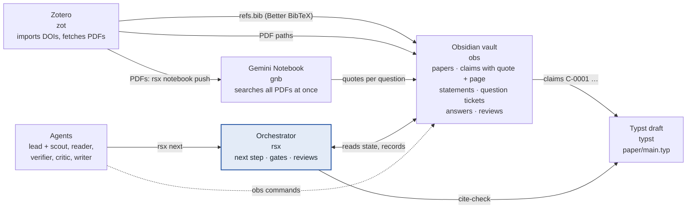

# litflow

A literature research workflow for AI agents. Each step is a skill with its own command:
import papers into Zotero, query them in a Gemini Notebook, record verified claims and their
citation chains in an Obsidian vault, and write in Typst. Agents verify and review each
other's work, and the commands enforce the rules so that smaller models can follow them.

| Skill | Description |
|---|---|
| [`gemini_notebook`](gemini_notebook/) | Query Google Gemini Notebook (formerly NotebookLM) notebooks from Claude Code and add sources (files, websites, YouTube, pasted text) to them. Fork of [PleasePrompto/notebooklm-skill](https://github.com/PleasePrompto/notebooklm-skill) (MIT) with fixes for the `notebook.google.com` rebrand. Comes with the `gnb` command. |
| [`zotero`](zotero/) | Import papers into Zotero by DOI with their PDFs, list a collection's PDFs, extract the DOIs papers cite, and upload PDFs to a Gemini Notebook. Drives the Zotero desktop app through the [Zotero MCP plugin](https://github.com/cookjohn/zotero-mcp). Comes with the `zot` command. |
| [`obsidian`](obsidian/) | A research vault in Obsidian markdown: papers from the Better BibTeX export, claims with verbatim quotes checked against the PDF, citation provenance across papers, question maps with a frontier, and a lint gate for agent workflows. Comes with the `obs` command. |
| [`research`](research/) | Runs the workflow. `rsx next` names the next step, the role that does it and the gate that checks it; five Pi agents (`lit-scout`, `lit-reader`, `lit-verifier`, `lit-critic`, `lit-writer`) do the work and check each other; `rsx cite-check` ties each cited sentence of the Typst draft to verified claims. Comes with the `rsx` command. |

## Status

Early: version 0.1. It has been used by one person, on macOS, for a few literature
reviews, and nobody else has set it up from scratch yet. Expect rough edges and please
report them as [issues](https://github.com/nfb2021/litflow/issues).

Known limitations:

- **Tested on macOS only.** CI installs and tests the commands on Ubuntu, so Linux should
  work. Windows does not: the snowball state is locked with `fcntl`, which Windows lacks.
- **Gemini Notebook is driven through its web page.** `gnb` controls Chrome with your Google
  login, as a person would click. It breaks when Google changes the page, and Google may
  limit automated use of an account. A notebook holds at most 50 sources on the free plan.
- **Zotero is driven through a third-party plugin**
  ([cookjohn/zotero-mcp](https://github.com/cookjohn/zotero-mcp)) with write access. `zot add`
  imports items, files them into collections, and writes a DOI into an existing item whose
  title and year match a DOI it was asked to import.
- **Paywalled PDFs** come only through your institution's network, VPN or Zotero proxy.
- **Reference lists come from Crossref**, which has them only when the publisher deposited
  them; otherwise the DOIs are read from the PDF.
- **Third-party parts have their own terms and licences**: Zotero, Better BibTeX, the Zotero
  MCP plugin, Gemini Notebook (Google's terms), Chrome, Pi, Typst and the typst skill.
  The code in each skill folder carries its own licence file.

## How the pieces fit



`rsx next` goes through the stages in order and returns the first one with open work. The
colour shows who does it: orange is you, grey the lead, cyan `lit-scout`, blue
`lit-reader`, green `lit-verifier`, red `lit-critic` and violet `lit-writer`.

```mermaid
flowchart LR
    fix["fix<br/>vault errors first"]

    subgraph setup [Set up]
        direction TB
        setupst["setup<br/>your choices + rsx check"] --> protocol["protocol<br/>criteria I1, E2 …"]
    end
    subgraph snow [Snowball]
        direction TB
        snowball["snowball<br/>references, N levels,<br/>judged + confirmed"]
    end
    subgraph ask [Ask]
        direction TB
        map["map<br/>question tickets"] --> grilling["grilling<br/>only you answer"]
    end
    subgraph collect [Collect]
        direction TB
        sync["sync<br/>refs.bib → vault"] --> screen["screen<br/>include / exclude"] --> pdf["pdf<br/>get missing PDFs"]
    end
    subgraph find [Find]
        direction TB
        notebook["notebook<br/>push PDFs, ask"] --> extract["extract<br/>claims, per paper"]
    end
    subgraph check [Check]
        direction TB
        verify["verify<br/>recheck each claim"] --> trace["trace<br/>find the origin"]
    end
    subgraph answerp [Answer]
        direction TB
        answer["answer<br/>one ticket each"] --> review["review<br/>try to break it"] --> stuck["stuck<br/>release dead tickets"]
    end
    subgraph write [Write]
        direction TB
        draft["write<br/>draft + cite-check"] --> draftreview["draft-review<br/>every sentence"]
    end

    fix --> setup --> snow --> ask --> collect --> find --> check --> answerp --> write

    classDef human fill:#fbe3d6,stroke:#c2410c,color:#18232b
    classDef lead fill:#e6eaed,stroke:#52606b,color:#18232b
    classDef scout fill:#d8f0f4,stroke:#0e7490,color:#18232b
    classDef reader fill:#dde8fd,stroke:#2563eb,color:#18232b
    classDef verifier fill:#dcf1e3,stroke:#15803d,color:#18232b
    classDef critic fill:#f8dddd,stroke:#b91c1c,color:#18232b
    classDef writer fill:#ebe2fd,stroke:#7c3aed,color:#18232b
    class setupst,protocol,grilling human
    class fix,map,sync,notebook,stuck lead
    class pdf,trace scout
    class snowball,screen,extract,answer reader
    class verify verifier
    class review,draftreview critic
    class draft writer
```



`rsx next` names the step, the role that does it (the user, the lead or one of the `lit-*`
agents) and the commands. Every step ends at a gate (`rsx gate STAGE`, one JSON verdict),
and no step starts while an earlier one has open work. An agent never checks its own work:
`obs` refuses a verifier who extracted the claim, `rsx` refuses a critic who wrote the
answer or the draft. A citation in the draft needs a verified claim of that paper in the
same paragraph. [docs/workflow.md](docs/workflow.md) has all the diagrams: the control loop,
how the Gemini Notebook is used, who checks whom, the coverage gate and citation tracing.
The commands are in [research/README.md](research/README.md).

## Requirements

| Software | Needed for | Install |
|---|---|---|
| macOS (Linux untested) | everything | |
| [uv](https://docs.astral.sh/uv/) and git | installing the four commands; uv brings Python ≥ 3.10 | `brew install uv git` |
| [Zotero](https://www.zotero.org) 7 or newer, running | `zot`, `rsx` | zotero.org |
| [Zotero MCP plugin](https://github.com/cookjohn/zotero-mcp/releases), *Enable Write Operations* ticked, port 23120 | `zot` reads and writes the library | `.xpi` from the releases page, see [zotero/README.md](zotero/README.md) |
| [Better BibTeX](https://retorque.re/zotero-better-bibtex/) for Zotero | `refs.bib`, which `obs`, `rsx` and Typst read | `.xpi` from its site |
| Google Chrome and a Google account with Gemini Notebook | `gnb`, `rsx notebook push` | google.com/chrome |
| [Typst](https://typst.app) 0.15 or newer | the draft | `brew install typst` |
| An agent harness: [Claude Code](https://claude.com/claude-code), or [Pi](https://pi.dev) with [pi-subagents](https://github.com/nicobailon/pi-subagents) for the five `lit-*` agents | running the workflow | see their docs |

Optional: `poppler` (`brew install poppler`) reads PDF columns better; `ocrmypdf` and
`tesseract-lang` make scanned PDFs readable; [Obsidian](https://obsidian.md) shows the vault
(plain markdown, so any editor works); your institution's VPN or proxy brings paywalled PDFs.

## Getting started

**1. Install the commands and skills** (once):

```bash
git clone https://github.com/nfb2021/litflow.git ~/src/litflow
for s in gemini_notebook zotero obsidian research; do
  uv tool install --editable ~/src/litflow/$s       # gnb, zot, obs, rsx
done
gnb auth setup        # a Chrome window opens: log in to Google
zot status            # ✅ … Write operations enabled
rsx doctor            # checks every tool above
```

For Claude Code, link the skills:

```bash
mkdir -p ~/.claude/skills
for s in gemini_notebook zotero obsidian research; do
  ln -s ~/src/litflow/$s ~/.claude/skills/$s
done
```

For Pi, `rsx pi install` loads the skills and the five agents. Each skill's README has
more on its setup. If a command is not found, run `uv tool update-shell` and open a new
terminal. To update later: `git -C ~/src/litflow pull`.

**2. Prepare a project** (once per review):

1. In Zotero, create an empty collection for the review.
2. In Gemini Notebook, create an empty notebook and copy its URL (or work without one).
3. Create the project and make your choices; the agent asks for each of them anyway:

   ```bash
   rsx init ~/research/my-review --title "My review"
   cd ~/research/my-review
   rsx config collection "my-review"
   rsx notebook use https://notebook.google.com/notebook/…
   rsx config depth 2               # levels of references to follow; 0 = none
   rsx config fetch zotero          # or manual: you add the papers yourself
   rsx snowball seed 10.xxxx/…      # the papers you start from
   ```

4. In Zotero, right-click the collection → *Export Collection…* → **Better BibTeX**, tick
   *Keep updated*, and save it as `refs.bib` in the project folder.
5. If papers are paywalled, connect to your institution's network or VPN.

**3. Run it.** Start your agent in the project folder and give it the question, e.g. *"Use
the research skill: what does the literature say about X?"*. The agent runs `rsx next`,
does the step it names, and passes that step's gate before moving on. You are asked at
the points that are yours: the inclusion criteria (`vault/protocol.md`), PDFs it cannot
get, questions only you can answer, and the draft. Run `rsx next` yourself any time to see
where the review stands.

**4. Read the results:**

- `vault/snowball.md`: every paper per level, who cites whom, and why each reference was
  included or excluded
- `vault/`: paper notes, claims with verbatim quotes and pages, questions and answers;
  open it as an Obsidian vault
- `paper/main.typ`: the draft (`typst compile paper/main.typ`), each citation backed by a
  verified claim

## Skills used from upstream

Documents are written in Typst with
[lucifer1004/claude-skill-typst](https://github.com/lucifer1004/claude-skill-typst) (MIT),
used as is and not copied here. Its repository keeps the skill in `skills/typst`, so link
that folder, not the clone:

```bash
git clone https://github.com/lucifer1004/claude-skill-typst.git ~/src/claude-skill-typst
ln -s ~/src/claude-skill-typst/skills/typst ~/.claude/skills/typst
```

It needs Typst 0.15 or newer (`brew install typst`). Cite with the Better BibTeX export that
`obsidian` reads, e.g. `#bibliography("refs.bib")`; `typst compile` fails on a citation key
that is not in the file.

## Contributing

Commits follow [Conventional Commits](https://www.conventionalcommits.org) with the skill
as scope, e.g. `feat(gemini_notebook): add source removal`. Hooks run ruff (lint and
format), `uv lock`, file checks and a GitGuardian secret scan before push:

```bash
uvx prek install --hook-type pre-commit --hook-type commit-msg --hook-type pre-push
uvx ggshield auth login        # once, for the secret scan
uvx prek run --all-files       # what CI runs
```

CI (`.github/workflows/`) runs the same hooks, checks every lock file, installs each
command as a uv tool and smoke-tests it, and scans for secrets. See [SECURITY.md](SECURITY.md)
for reporting vulnerabilities.
