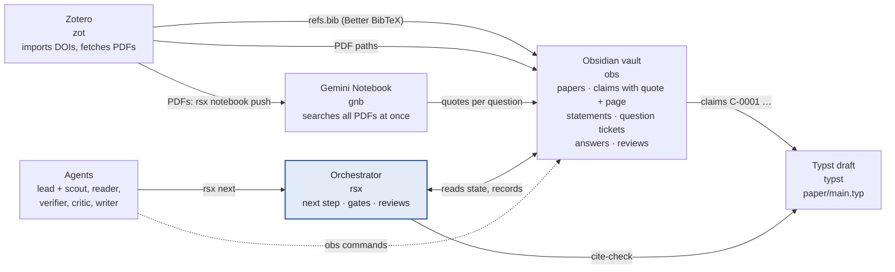
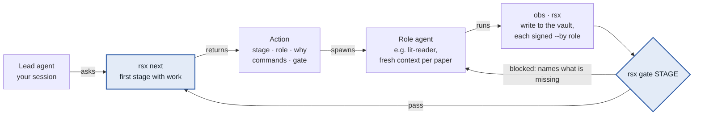
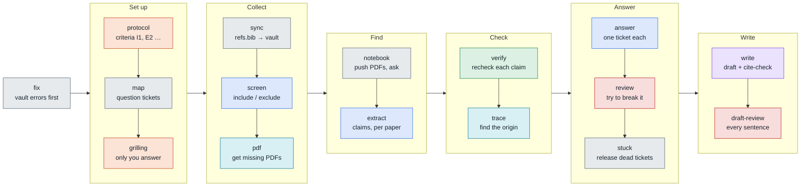
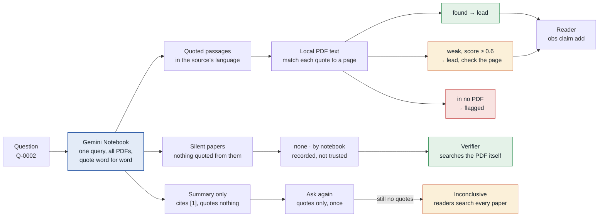
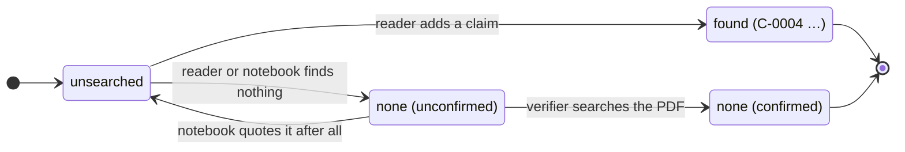
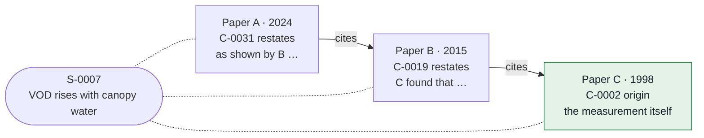

# How litflow works

Agents read papers and propose claims. The tools check every claim against the PDF, and a
second agent checks what the first one did. No step depends on a model following its
instructions.

- **Quote or it didn't happen.** A finding counts only as a word-for-word quote that can be
  found on its PDF page.
- **Never your own judge.** The verifier is never the reader, and the critic never reviews
  its own text.
- **Tools decide the next step.** `rsx next` names the next step, and `rsx gate` says pass or
  blocked.
- **You answer the real choices.** Only you settle the protocol and answer grilling
  questions.

Colours in the diagrams mark who does a step:

| Colour | Role |
|---|---|
| orange | you |
| grey | lead (your agent session) |
| cyan | `lit-scout` |
| blue | `lit-reader` |
| green | `lit-verifier` |
| red | `lit-critic` |
| violet | `lit-writer` |

## 1. The parts

Each tool is a small command-line program with its own skill. The Obsidian vault in the
middle holds every paper, claim, question and answer as markdown. It is the shared memory
all agents read and write.

Zotero collects the papers. Better BibTeX keeps `refs.bib` current, and `obs paper sync`
reads it into the vault. The same PDFs go to the Gemini Notebook, which finds passages
quickly; the local PDF text is what each claim is checked against.

## 2. The control loop

A weak model loses track of where a review stands. The lead agent doesn't have to remember
the plan: it asks `rsx next`. That command reads the vault, `refs.bib` and the draft, and
names one step: the stage, the role that does it, why, and the exact commands.

Every write names its author (`--by lit-reader`), and a guard stops the lead from signing
as another role. A gate that blocks names what is missing, so the next step comes from the
tool and not from the model's memory.

## 3. The method: sixteen stages, earliest unfinished first

The stage order is the method. `rsx next` goes through it from left to right and stops at
the first stage that still has work. When a new paper or a new question arrives, the
earlier stages have work again, so they come first. `fix` comes before every stage: if
`obs lint` finds an error (a quote not on its page, a broken link), nothing else runs until
it is fixed.

The `pdf` stage runs while `extract` is going on, so the scout fetches missing PDFs while
readers work. In `trace`, the scout imports cited papers and a reader checks them. Answer
tickets go to a role by their kind. The run ends at `done` once the draft is written,
cite-checked and passed by the critic.

## 4. The notebook finds, the PDF judges

Gemini Notebook is good at searching 50 papers at once, but its words are not evidence.
`rsx ask` sends one query per question across all papers. Each quoted passage is then
matched to a page of the local PDF. Only the text copied from that page becomes a lead, and
a reader turns it into a claim.

If the second answer does quote, its quotes go through the same page matching. Leads are
taken from the PDF page itself, including OCR errors, so a reader can paste one
into `obs claim add` and the quote check passes. In the live test on the 1905 scan, the
notebook gave 32 leads across 5 questions, every one found in the German OCR text. Two of
the first five answers were English summaries; asked again, both came back with quotes.

## 5. Who checks whom

A model is worst at catching its own mistakes, so each piece of work goes to a different
agent with a fresh context. A block sends the work back with line-level findings, never
just a verdict.

```mermaid
flowchart LR
    reader["Reader<br/>claim = quote + page"]
    verifier["Verifier<br/>not the reader"]
    answerer["Answerer<br/>links its claims"]
    critic1["Critic<br/>tries to break the answer"]
    writer["Writer<br/>// C-0001 per paragraph"]
    critic2["Critic<br/>every sentence of the draft"]

    reader -- "obs: quote is on the page" --> verifier
    verifier -- "obs verify" --> answerer
    answerer -- "rsx gate answer" --> critic1
    critic1 -- "pass, bound to the text hash" --> writer
    writer -- "rsx cite-check" --> critic2
    critic1 -. "blocked: Review section" .-> answerer
    critic2 -. "blocked: --finding 'line N: problem -> fix'" .-> writer

    classDef reader fill:#dde8fd,stroke:#2563eb,color:#18232b
    classDef verifier fill:#dcf1e3,stroke:#15803d,color:#18232b
    classDef lead fill:#e6eaed,stroke:#52606b,color:#18232b
    classDef critic fill:#f8dddd,stroke:#b91c1c,color:#18232b
    classDef writer fill:#ebe2fd,stroke:#7c3aed,color:#18232b
    class reader reader
    class verifier verifier
    class answerer lead
    class critic1,critic2 critic
    class writer writer
```

The edge labels are the check a tool makes at each hand-off. A review is bound to the hash
of the text it read, so editing the text afterwards voids the pass.

In the Haiku run (eval5c, Einstein 1905), the critic blocked the first draft with six line
findings, among them a rule given without the condition Einstein attaches to it and a year
that no cited quote contains. The writer revised and the critic passed the revision. Nobody
stepped in. Result: 19 of 19 claims verified by a second agent, 6 of 6 questions answered
and reviewed, 0 cite-check issues in the final draft.

## 6. The coverage gate

Reviews go wrong most quietly through papers nobody read for a question. `rsx coverage`
keeps a grid of every question against every included paper. A cell that says "not in this
paper" counts only once a second agent has confirmed it. The draft stage stays closed until
every cell is done.

Each cell of the grid moves through these states:

An example grid, with made-up paper keys:

| | moss2021canopy | ilves2023gnss | kaur2019review |
|---|---|---|---|
| Q-0001 | found: C-0004, C-0005 | none (confirmed) | found: C-0011 |
| Q-0002 | none (unconfirmed): only the notebook says so | found: C-0008 | unsearched |
| Q-0003 | unsearched: the notebook gave a summary only | none (confirmed) | found: C-0014 |

`rsx next` sends each open cell to the right role: unsearched cells to a reader,
unconfirmed ones to the verifier.

## 7. Provenance: following a statement to where it started

Papers repeat each other. A claim marks whether its paper makes a statement first
(`origin`) or restates it from someone else (`restates`, with the paper it cites).
`obs trace` follows that chain. When the cited paper isn't in the vault yet, the trace
stage has the scout import it, and a reader checks whether it really says what it is cited
for.

The draft can then cite the origin, or say which papers restate it. A chain that ends at a
paper which doesn't support the statement is caught here and not left in the draft.
